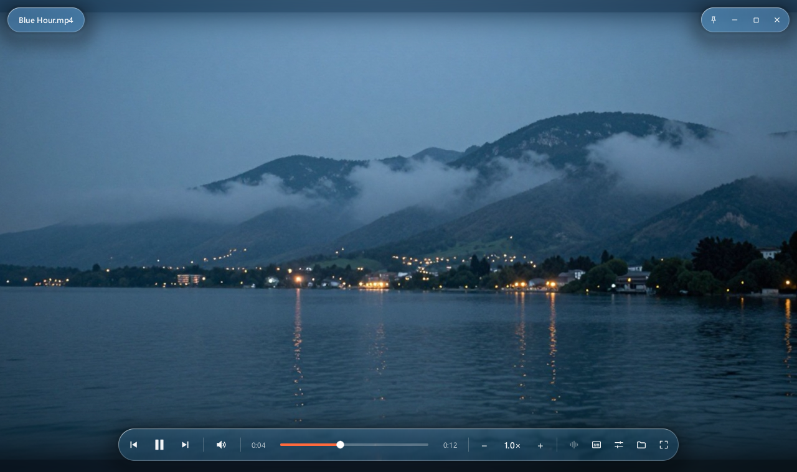
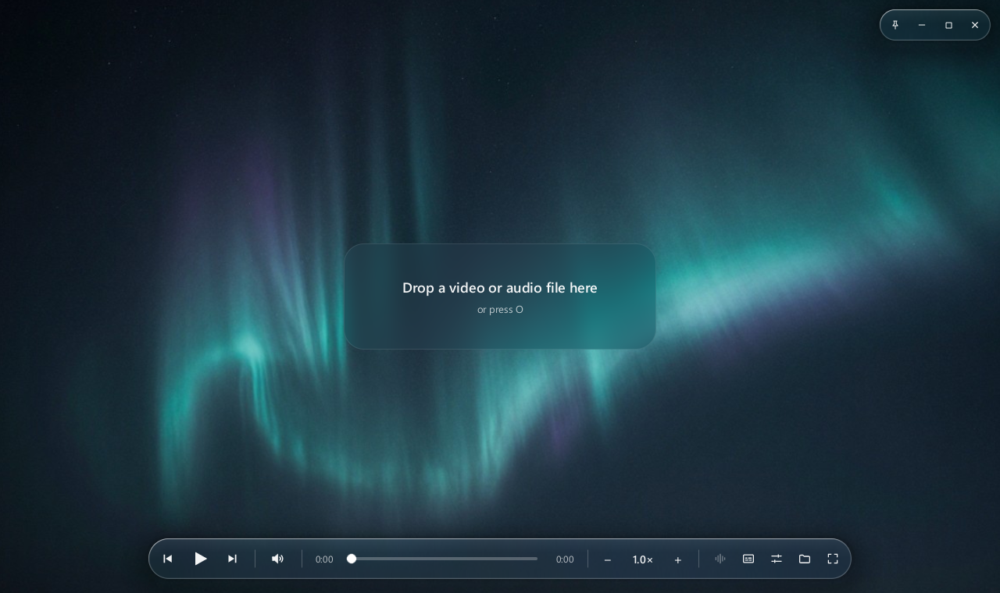
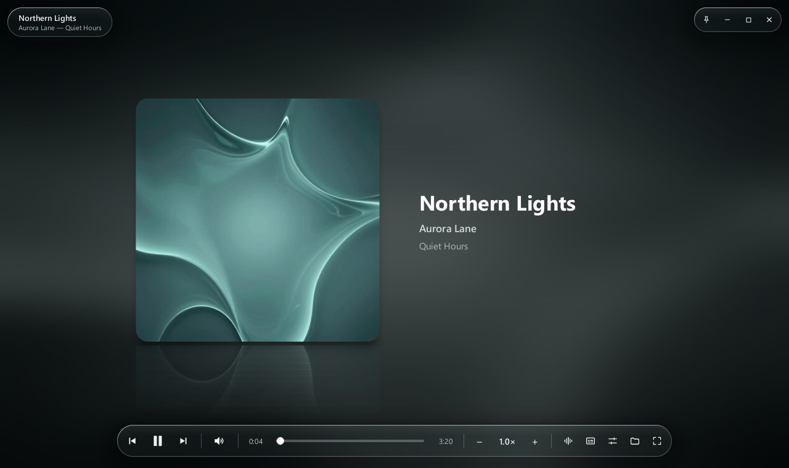
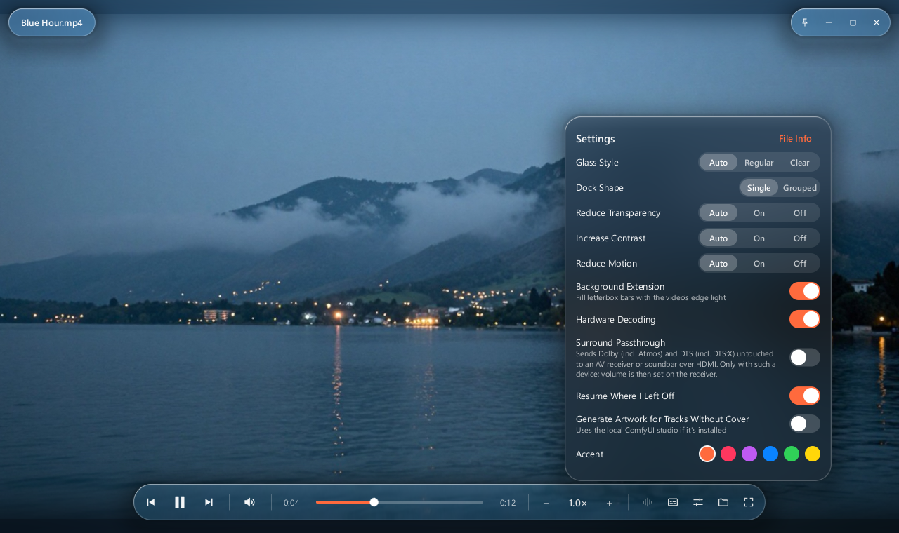
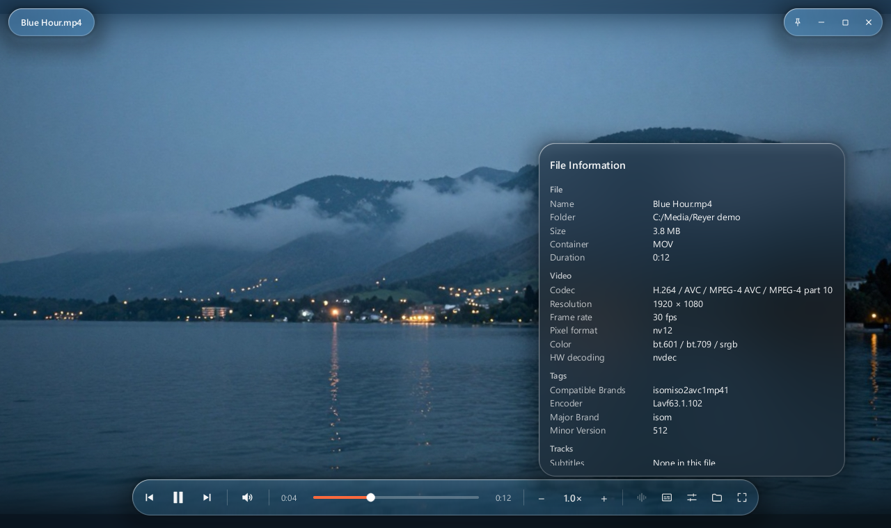

# Reyer



A small video and audio player for Windows 10/11 with a Liquid Glass interface. The controls float over the video as real glass, rendered on the GPU: the moving frame behind them is blurred and refracted. Motion runs on interruptible springs. The window comes back exactly where you left it.

Playback is done by [libmpv](https://mpv.io), so anything mpv/ffmpeg can decode will open, Apple formats included (`.mov`, `.m4v`, `.m4a`, `.m4b`, `.caf`, `.aiff`, ALAC, HEVC, ProRes).

## Download

Get `Reyer-<version>-windows-x64-setup.exe` from [Releases](https://github.com/reyjendiz/Reyer/releases/latest) and run it. It installs for the current user without admin rights (or for everyone if you choose so) and can register Reyer for video and audio files. Prefer no installer? Take `Reyer-<version>-windows-x64.zip`, unpack it anywhere and run `Reyer.exe`. libmpv is included in both. Windows 10/11 x64.

## Screenshots

| | |
|---|---|
|  |  |
|  |  |

## Features

- **Window memory.** Reyer opens at the size and position it had when you closed it, always windowed: closing it fullscreen or maximized brings back the last normal window. It never resizes the window to fit the video; the video letterboxes inside.
- **Opens everything.** Use the open dialog (All files by default), drag and drop files or folders, pass a file on the command line, or set Reyer as the default app. Unknown extensions are still tried. Old iTunes DRM files (`.m4p`) show a clear message instead of failing silently.
- **Audio is first-class.** Audio files get a Now Playing screen: the embedded cover (or generated artwork tinted from the title) over a softly blurred, color-matched background, with the title, artist and album from the tags.
- **Folder playlist.** Opening a file queues the rest of its folder in natural order (track2 before track10). Playback advances automatically at the end of each file. Previous restarts the current track if you're more than 4 s in.
- **Speed buttons.** The dock has `[ − ] 1.0× [ + ]`: each press moves 0.25× (from 0.25× to 4×), clicking the number resets to 1×, and holding or right-clicking it shows presets. Pitch stays natural at every speed.
- **Liquid Glass.** Clear glass for the dock and window buttons over video (it dims itself over bright scenes), and Regular glass for menus, toasts and popovers. A specular rim follows the pointer, popovers grow out of their buttons, and slider knobs turn into small lenses while you touch them.
- **Background extension.** Letterbox bars glow with soft, blurred light from the picture itself instead of flat black.
- **Surround passthrough.** Optionally sends Dolby (including Atmos) and DTS (including DTS:X) untouched to an AV receiver or soundbar over HDMI. If the output can't take it, Reyer decodes instead.
- **File information.** Settings → File Info (or I) shows the file's container, codecs, resolution, frame rate, color/HDR, audio format, tags and tracks.
- **Subtitles.** Embedded tracks and same-named subtitle files next to the video load automatically; any other file can be added from the subtitles menu.
- **Accessibility.** Reyer follows the Windows settings for transparency effects, high contrast and animation effects, and each can be overridden in Settings. The whole player works from the keyboard.

## Setup

Requires Windows 10 or 11 (x64) and the [Rust toolchain](https://rustup.rs) (stable, 2021 edition) to build from source.

### Getting libmpv

Reyer needs `libmpv-2.dll` next to `Reyer.exe` (or in the project folder when running with `cargo run`).

1. Open <https://github.com/shinchiro/mpv-winbuild-cmake/releases> (the Windows build mpv.io links to).
2. Download the latest `mpv-dev-x86_64-<date>-git-<hash>.7z`. The `-v3` variant is a little faster on CPUs from 2015 onward.
3. Extract `libmpv-2.dll` from the archive into the project folder.

If the DLL is missing, Reyer shows a dialog explaining this instead of crashing.

## Running

```bash
cargo run --release
```

You can also pass files or folders to open:

```bash
cargo run --release -- "D:\Music\Album"
```

Hardware decoding uses `hwdec=auto-safe`. To override it, set `REYER_HWDEC` (for example `REYER_HWDEC=no` or `d3d11va`), or turn it off in Settings.

To save a screenshot of the first frames and exit (handy for visual checks), pass `--shot out.png [--shot-after <ms>] [--rect x,y,w,h]`.

## Keyboard

| Key | Action |
|---|---|
| Space | Play / pause |
| ← / → | Seek 5 s (Shift: 1 s, Ctrl: 30 s) |
| ↑ / ↓ | Volume ±5% (up to 150%: past 100% is a boost for quiet files) |
| M | Mute |
| F, Enter | Full screen |
| Esc | Close menu / leave full screen |
| O, Ctrl+O | Open |
| N, Page Down / P, Page Up | Next / previous |
| `]` / `[` / Backspace | Faster / slower / normal speed |
| A / S | Next audio / subtitle track |
| I | File information |
| T | Keep on top |
| Home | Back to the start |
| Ctrl+V | Play a path or URL from the clipboard |
| Ctrl+, | Settings |
| Tab | Move between controls (Space/Enter press, arrows adjust) |

With the mouse: click the video to play or pause, double-click for full screen, drag to move the window, and scroll to change the volume.

## Building Reyer.exe

```bash
powershell -ExecutionPolicy Bypass -File build.ps1
```

This runs `cargo build --release` and produces a single-folder app in `dist\Reyer\` (with `Reyer.exe`, libmpv and the runtime images). Shaders, design tokens and the icon are embedded in the executable. Copy that folder anywhere. Add `-Installer` to also build the setup exe with [Inno Setup 6](https://jrsoftware.org/isdl.php) (`installer\Reyer.iss`).

## Making Reyer the default player

After building:

```bash
powershell -ExecutionPolicy Bypass -File tools\register_associations.ps1
```

The script registers Reyer for the current user for every video and audio type it plays, Apple types included (`.mov .qt .m4v .mp4 .m4a .m4b .m4r .caf .aif .aiff .aifc .alac` and the rest). It then opens Windows "Default apps", where you pick Reyer: Windows doesn't let programs make themselves the default without asking. Pass `-Exe <path>` if `Reyer.exe` lives elsewhere, or `-Unregister` to remove everything.

## Settings

Settings are stored in `%APPDATA%\Reyer\settings.json`:

- last window rectangle, volume and mute
- glass style (Auto / Regular / Clear), dock shape (Single / Grouped) and accent color
- background extension
- accessibility overrides
- hardware decoding
- resume positions
- last folder

Open them with the sliders button in the dock, or Ctrl+,.

## Artwork

The icon, the empty-state backgrounds and the Now Playing fallback tiles were generated on this PC with a local ComfyUI install (two to four candidates per prompt, picked by eye). Prompts and seeds are in [assets/PROMPTS.md](assets/PROMPTS.md). Reyer doesn't need ComfyUI to run.

One optional setting, "Generate Artwork for Tracks Without Cover" (off by default), uses a local ComfyUI at `E:\ComfyUI` (or `REYER_COMFYUI`) to paint an abstract cover for tracks without one. It runs in the background and is skipped while a video plays. Results are cached in `%APPDATA%\Reyer\art-cache`.

## Development

```bash
cargo test
```

Shaders live in `assets/shaders` (GLSL 3.30) and are embedded at build time, so there is no separate shader build step.

- `src/mpv.rs`, `src/player.rs`, `src/playlist.rs`, `src/media.rs`: libmpv bindings, playback state, playlist, media types
- `src/settings.rs`, `src/geometry.rs`, `src/speed.rs`, `src/volume.rs`, `src/art.rs`: settings, window geometry, speed and volume curves, ComfyUI client
- `src/win.rs`, `src/shell.rs`, `src/app.rs`: native window code, window and frame loop, application
- `src/gfx`: OpenGL renderer (rectangles, text, icons, glass, blur)
- `src/ui`: immediate-mode interface (dock, title pill, popovers, panels, toasts)
- `assets/shaders`: glass, blur, edge and lens shaders
- `assets/design-tokens.json`: every color, spacing, radius, blur, spring and timing value

Notes on how and why things are built are in [docs/DECISIONS.md](docs/DECISIONS.md), and the manual test list is in [docs/TEST_CHECKLIST.md](docs/TEST_CHECKLIST.md).

## License

GPL-3.0, see [LICENSE](LICENSE). The release bundles [libmpv](https://github.com/mpv-player/mpv) (GPL-2.0+, Windows build from [shinchiro/mpv-winbuild-cmake](https://github.com/shinchiro/mpv-winbuild-cmake)). The executable is built from Rust crates (winit, glutin, glow, fontdue, lofty and others) under permissive licenses.
